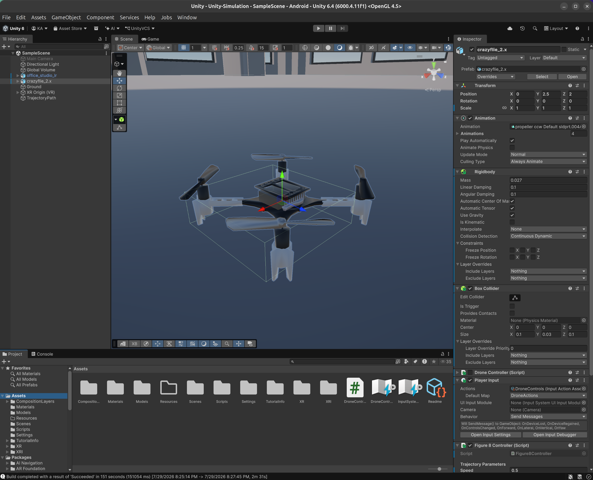

# Crazyflie-Figure8-Simulation
Simulation environment of Crazyflie following a Figure-8 tajectory in Unity.

**Real drone:** Python scripts that fly the same figure-8 with person avoidance on a real Crazyflie 2.1 (Flow deck v2 + Multi-ranger) are in [CrazyFlie-Nanodrone/hardware](CrazyFlie-Nanodrone/hardware/README.md). Start with that README.

